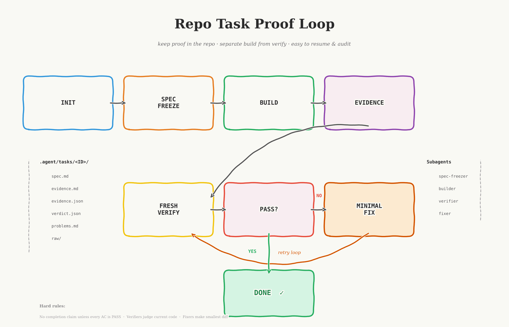

# Repo Task Proof Loop

This skill was built from [OpenClaw-RL: Train Any Agent Simply by Talking](https://arxiv.org/html/2603.10165v1) and applies its proven approach to agentic flows in a repo-local workflow.

> "next-state signals are universal, and policy can learn from all of them simultaneously."

Repo Task Proof Loop is a repo-local workflow skill for non-trivial coding tasks.

On explicit invocation, it creates a durable task folder under `.agent/tasks/<TASK_ID>/` and drives a proof loop. Codex project role templates and guidance are optional, separately approved integrations:

`spec freeze -> build -> evidence -> independent verify -> minimal fix -> same-verifier recheck`

For Codex, that loop also supports an adaptive bounded fan-out path for `explorer` or `worker` children when the task splits cleanly.

The point is simple: keep proof inside the repository, separate implementation from verification, and make task state easy to resume or audit later.



## What It Creates

Inside the target repository:

```text
.agent/tasks/<TASK_ID>/
  spec.md
  evidence.md
  evidence.json
  raw/
    build.txt
    test-unit.txt
    test-integration.txt
    lint.txt
    screenshot-1.png
  verdict.json
  problems.md

.codex/agents/
  task-spec-freezer.toml
  task-builder.toml
  task-verifier.toml
  task-fixer.toml

```

The `.codex/agents/` files require `--install-subagents codex`; default initialization creates only `.agent/tasks/<TASK_ID>/`. `--guides agents` separately opts in to a managed block in:

- the repo-root `AGENTS.md` Codex baseline

Both configuration changes require explicit approval. Differing existing agent files are preserved with an error. Claude-specific assets are retained as upstream reference material, not an active integration.

## Install

Use the host's managed skill installer and deployment policy when present.

### Codex

```text
.agents/skills/repo-task-proof-loop/
```

## Quick Prompts

Use this prompt for the normal flow:

### Do Task

```text
Use $repo-task-proof-loop for the task below. Reuse the canonical spec and plan. Initialize task artifacts if needed, without changing project instructions or agent configuration. Collect evidence, then use one read-only verifier started with fork_context=false and reused for corrections. Keep unresolved requirements explicit if blocked or a resource limit is reached.
...
```

For all prompts, replace `...` with either `Task file: <path/to/task-file.md>` on the next line or the task text pasted on following lines.

This skill is intentionally proof-first, so `init` always comes before build.

For users, the intended interaction stays simple: run Codex, mention `$repo-task-proof-loop`, and describe the task.

## Quick Start

1. Install the skill in the repository.
2. For the normal flow, use the [Do Task prompt](#do-task) or mention Repo Task Proof Loop (`$repo-task-proof-loop`) and describe the task.
3. That's it.

## Helper Script

The bundled helper script currently ships three CLI commands:

- `init` - create task artifacts; project guides and Codex role templates are opt-in
- `validate`
- `status` - inspect an existing initialized task

The workflow phases `freeze`, `build`, `evidence`, `verify`, `fix`, and `run` are skill-level commands for the agent, not direct CLI subcommands in this package.

Set `SKILL_PATH` to the installed skill directory:

### Codex example

```bash
SKILL_PATH=.agents/skills/repo-task-proof-loop
```

Initialize a task:

```bash
python3 "$SKILL_PATH/scripts/task_loop.py" init \
  --task-id feature-auth-hardening \
  --task-file docs/tasks/auth-hardening.md
```

Or seed from inline text:

```bash
python3 "$SKILL_PATH/scripts/task_loop.py" init \
  --task-id feature-auth-hardening \
  --task-text "Implement auth hardening for session refresh and logout."
```

Validate:

```bash
python3 "$SKILL_PATH/scripts/task_loop.py" validate \
  --task-id feature-auth-hardening
```

Run `validate` only after `init` completes. If it reports initialization in progress, wait and rerun.

Status:

```bash
python3 "$SKILL_PATH/scripts/task_loop.py" status \
  --task-id feature-auth-hardening
```

Use `status` after `init` completes when you want stable task state. If it returns `init_in_progress: true`, retry after `init` finishes.

Useful options:

- `--guides auto|agents|none` (default `none`)
- `--install-subagents codex|none` (default `none`)
- `--force` (overwrite task templates only; requires approval)

`--guides auto` is an explicit alias for `--guides agents`. Neither is needed to run the workflow.

## Validation

The package includes a smoke test:

```bash
python3 "$SKILL_PATH/scripts/verify_package.py"
```

It checks default initialization, opt-in integrations, preservation, structural validation and read-only status in temporary repositories. `validate` checks structure, not whether the implementation satisfies the task; placeholder evidence is still UNKNOWN.

## More Detail

The exact role prompts and platform-specific guidance live in:

- `references/COMMANDS.md`
- `references/SUBAGENTS.md`
- `references/REFERENCE.md`
- `SKILL.md`
